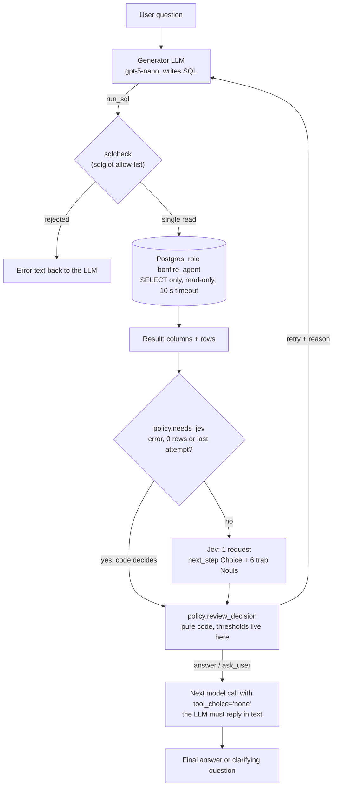

# Bonfire

A SQL-analysis agent over the [Olist](https://www.kaggle.com/datasets/olistbr/brazilian-ecommerce) e-commerce
database that uses **Jev** (TypeSafe's System One model) to decide whether each query result actually answers the
user's question.

The agent is a LangChain v1 `create_agent` with one tool, `run_sql`. After every query runs, one Jev request judges
the question, the SQL and the result, and code decides what happens next: answer, rewrite the query, or ask the user
to clarify. Safety does not depend on Jev: Postgres permissions, an SQL allow-list and a timeout keep the database
safe before any query runs.

This is not a benchmark. Nothing compares Jev against an LLM judge or against other configurations; the evaluation
measures whether this one application works.

- [1. How a question flows](#1-how-a-question-flows)
- [2. What Jev receives and returns](#2-what-jev-receives-and-returns)
- [3. The rubric](#3-the-rubric)
- [4. Results](#4-results)
- [5. Where Jev failed](#5-where-jev-failed)
- [6. Limitations](#6-limitations)
- [7. Reproduce](#7-reproduce)
- [8. Threat model](#8-threat-model)
- [9. What leaves the system, and to whom](#9-what-leaves-the-system-and-to-whom)
- [Project layout](#project-layout)

---

## 1. How a question flows



The pieces, in order:

| Step | Where | What it does |
|---|---|---|
| Generator | `src/agent/build.py`, `prompts/sql_agent.md` | `create_agent` with `gpt-5-nano` (set in `bonfire.toml`), the schema in the system prompt, no trap hints. |
| `sqlcheck` | `src/sqlcheck.py` | Rejects anything that is not exactly one read statement, any node that writes or changes the session, and joins without a condition (rules R1–R5). |
| `run_sql` | `src/agent/tools.py` | New read-only connection per call as `bonfire_agent`, 10 s `statement_timeout`, at most 200 rows. |
| Review | `src/middleware/review.py` | `wrap_tool_call` runs `run_sql`, asks Jev, applies the policy, and appends `Reviewer: <decision>. <reason>` to the tool message the LLM reads. `wrap_model_call` forces `tool_choice="none"` after `answer` or `ask_user`. |
| Jev | `src/questions/review.py` | Builds the state and the questions, makes one `system_one` call, returns a `ReviewVerdict`. |
| Policy | `src/policy.py` | In order: attempt cap (4) → answer; SQL error or 0 rows → retry without Jev; any trap ≥ 0.5 → retry with that trap's reason; otherwise Jev's `next_step`. |

A trap above the threshold beats `next_step = answer` on purpose: the trap carries a concrete reason the LLM can act
on. In the runs, that rule caught errors `next_step` let through (t06 below).

The API (`src/api.py`) exposes the same agent:

```bash
curl -s -X POST http://127.0.0.1:8000/ask -H "Content-Type: application/json" \
     -d '{"question": "How many customers are there?"}'
```

```json
{
  "answer": "There are 96,096 unique customers (based on distinct customer_unique_id).",
  "kind": "answer",
  "attempts": [
    {"sql": "SELECT COUNT(*) AS customer_count FROM customers;", "error": null, "row_count": 1,
     "decision": "retry", "reason": "customer_id is created once per order, so it does not identify a person. ..."},
    {"sql": "SELECT COUNT(DISTINCT customer_unique_id) AS customer_count FROM customers;", "error": null,
     "row_count": 1, "decision": "answer", "reason": "The result answers the question. Reply to the user now."}
  ]
}
```

The run behind this response is real (Langfuse trace `7909f70c…`, 2026-10-19). The JSON is assembled from that
trace, because the API was written afterwards. There is no state between requests: when the review decides
`ask_user`, the response has `"kind": "clarification"` and the user rephrases in a new `POST /ask`.

## 2. What Jev receives and returns

One request per reviewed attempt, from the trace of the question above (first attempt, `jev-1.13.0`). The state:

```json
{
  "question": "How many customers are there?",
  "sql": "SELECT COUNT(*) AS customer_count FROM customers;",
  "result": {"columns": ["customer_count"], "row_count": 1, "rows": [[99441]], "rows_omitted": false},
  "schema_notes": [
    "customers.customer_id is created once per order, so a person who ordered three times has three customer_id values; customer_unique_id identifies the person.",
    "order_items has one row per unit sold, so an order can have several rows.",
    "...8 facts about the Olist schema in total, see SCHEMA_NOTES in src/questions/review.py"
  ]
}
```

The questions (two of the seven shown; the full set is in [section 3](#3-the-rubric)):

```python
"next_step": Choice(
    instructions="What should the SQL agent do with this `result`, given the user's `question`, the `sql` "
                 "it ran and the facts in `schema_notes`?",
    criteria={"answer": "...", "retry": "...", "ask_user": "..."},
),
"customer_id_not_unique": Noul(
    instructions="The `sql` counts or groups customers as people using customer_id instead of customer_unique_id.",
    criteria={"true": "For example COUNT(*) FROM customers, ...", "false": "..."},
),
```

The response:

```json
{
  "model": "jev-1.13.0",
  "answers": {
    "next_step": {"type": "choice", "choice": "retry", "confidence": 0.95,
                  "probabilities": {"answer": 0.02, "retry": 0.97, "ask_user": 0.01}},
    "customer_id_not_unique": {"type": "noul", "noul": 0.91},
    "join_fanout": {"type": "noul", "noul": 0.03},
    "wrong_grain": {"type": "noul", "noul": 0.84},
    "wrong_date_column": {"type": "noul", "noul": 0.03},
    "undelivered_as_sales": {"type": "noul", "noul": 0.02}
  },
  "usage": {"input_tokens": 1274, "output_tokens": 135}
}
```

A `Noul` answer is the probability that the statement is true (0.5 means "doesn't know"); it has no separate
confidence. The policy turned this into `retry` with the reasons of both traps above 0.5. The second attempt
(`COUNT(DISTINCT customer_unique_id)` = 96,096) got every trap ≤ 0.03 and `answer` 1.0.

Facts about the schema go in the state; the criteria for judging go in the questions. The question IDs are never
sent to the model, they are for the code.

## 3. The rubric

Seven questions in one request, defined in `QUESTIONS` (`src/questions/review.py`). Each trap's reason for the LLM
is in `TRAP_REASONS` (`src/policy.py`); a test checks that the two sets of keys match.

**`next_step` (Choice: `answer`, `retry`, `ask_user`).** The overall verdict. `retry` covers SQL that measures
something other than what was asked, the wrong rows, the wrong column or filter, or an implausible value. `ask_user`
covers questions with several reasonable readings, or that this database cannot answer.

**The six traps (Noul).** Each one is a way SQL runs fine and answers wrong on Olist. They came from watching the
generator fail, and the numbers were measured in psql on 2026-10-06 (`eval/README.md`):

| Trap | What the SQL does wrong | Why it matters on Olist |
|---|---|---|
| `customer_id_not_unique` | counts or groups people by `customer_id` | `customer_id` is created once per order: 99,441 IDs for 96,096 people (+3.5%). The generator did this in every run that tempted it. |
| `join_fanout` | sums or counts after a join that repeats rows | payments summed after joining `order_items`: 20.31 M instead of 16.01 M (+26.9%); `geolocation` has ~53 rows per zip prefix. |
| `wrong_grain` | counts rows of a table whose row is not the asked entity | `order_items` rows as orders: 112,650 vs 98,666 (+14.2%); `order_reviews` rows as reviews: 99,224 vs 98,410. |
| `wrong_date_column` | filters by a different date than the question's event | orders of 2017: 45,101 by purchase date, 40,930 by delivery date (−9.2%). |
| `undelivered_as_sales` | counts undelivered orders as sales | 2,963 of 99,441 orders are not delivered (3.0%). The question decides the scope: the trap only applies when it asks about sales, items sold or revenue. |
| `status_as_event` | requires `order_status` to equal the asked event | "approved in January 2018": 7,187 by `order_approved_at`, 0 with `order_status = 'approved'`, because `order_status` is the current status, not the history. Added 2026-11-02 after t08 failed three runs in a row. |

How the wording was tuned: Jev reads questions literally (its documented behavior, see
[limitations](#6-limitations)). When it flagged correct SQL, the question was reworded, never the threshold moved.
`undelivered_as_sales` first flagged payment totals as "revenue" (t03/t04 at 0.82/0.77); adding the question's scope
to the wording dropped them to 0.06/0.04 while the real errors stayed at 0.96/0.93. `status_as_event` excludes, in its
`false` criteria, questions about the current status ("have the status 'canceled'") and `order_status = 'delivered'`,
which is the last status and drops nothing.

Rejected: untranslated category names (the translation join loses 13 products and changes no number). Parseable
problems (cartesian products, joins without a predicate, non-SELECT statements) are not Jev questions: `sqlcheck`
rejects them before the SQL runs.

**Threshold.** One threshold for every trap, `PITFALL_MIN = 0.5`. In the hand check of 2026-10-08 (`jev-1.13.0`),
correct SQL kept every trap below 0.2 and real errors scored 0.69–0.97.

## 4. Results

**Setup.** 20 questions with hand-written reference SQL: 10 normal ones (`eval/questions_dev.jsonl`) and 10 built
to tempt one trap each, two per trap (`eval/questions_traps.jsonl`). Each run is a Langfuse experiment
(`eval/run_eval.py`). A question is correct when the result of the agent's **last successful query** matches the
reference result: values compared as a multiset, column names and order ignored, numbers rounded to 2 decimals, row
order only for rankings (`eval/grading.py`). A review is a **false positive** when it sent a correct result back for
a retry or a clarification (`label_attempt` in `eval/grading.py`).

**Runs of 2026-10-19**, one run per file, generator `gpt-5-nano-2025-08-07`, reviewer `jev-1.13.0`, five traps
(`status_as_event` did not exist yet):

| Run | False positives (correct results Jev reviewed) | Errors caught (wrong results Jev reviewed) | Accuracy | Latency p95 | Cost / question | Attempts / question |
|---|---|---|---|---|---|---|
| dev (10) | 0 / 10 | — (none were wrong) | 1.0 | 10.7 s | US$ 0.00053 | 1.0 (max 1) |
| traps (10) | 0 / 8 | 5 / 6 | 0.8 (0.9, see t10) | 17.1 s | US$ 0.00076 | 1.5 (max 2) |
| **total (20)** | **0 / 18 (0%)** | **5 / 6** | **0.9** | **16.6 s** | **US$ 0.00064** | **1.25 (max 2)** |

Latency, cost and attempts are per question, not per attempt. The cost is the generator's cost as computed by
Langfuse plus Jev's tokens at US$ 0.042 per million (typesafe.ai/pricing, 2026-11-02); Jev is about 1,300–1,500
tokens per call, around US$ 0.00006. Without Jev, the same 10 trap questions scored 4/10
(`eval/results/traps.json`, 2026-10-07): the reviewer rescued t01, t02, t06, t09 and t10, one retry each.

**Phase 6 exit criterion** (false positives on real agent traffic ≤ 5%): met on these runs, 0 of 18.

**Hand check of 2026-11-02**, after adding `status_as_event` and with `jev-latest` now answering `jev-1.14.0`: Jev
was run by hand on the generator's SQL for the 10 trap questions (from `traps.json`). With the policy's rule, all 10
decisions are right: the 6 wrong queries have a trap above 0.5 (lowest: t06 `wrong_grain` 0.60; t08
`status_as_event` 0.88), and the 4 correct ones have no trap above 0.3.

**Not run: three repetitions per file with the six traps and `jev-1.14.0`.** The code is ready
(`eval/run_eval.py` records every attempt, `eval/report.py` builds the table, `flag_review.csv` and the raw data in
`eval/results/`), but on 2026-11-02 the OpenAI key behind the generator had expired and every question failed at
the first model call. Those six failed runs (`dev_k1`…`traps_k3`) are in Langfuse; `eval/report.py` skips runs where
every question failed. See [Reproduce](#7-reproduce).

## 5. Where Jev failed

- **t08, missed, in every run before the sixth trap.** "How many orders were approved in January 2018?" The
  generator filtered `order_status = 'approved'` and got 0 (the answer is 7,187). No trap covered it, the zero-rows
  rule did not fire (a `COUNT` of 0 is one row), and `next_step` said `answer` at 0.82 even though its `retry`
  criteria mention "an implausible value such as 0". `status_as_event` now catches it (0.88 by hand); it has not
  been measured in a full run yet.
- **t10, graded wrong but right.** The agent answered `beleza_saude`, the Portuguese name of the category. The
  reference uses the English name; the Portuguese one is an accepted reading (`acceptable_sql`), which `run_eval`
  does not read yet. Left as is on purpose for this stage, so the trap accuracy shows 0.8 instead of 0.9.
- **No false positives so far.** The closest call was d03 (average review score), `wrong_grain` at 0.38 on a correct
  query. If a run pushes it past 0.5, the fix is rewording that question.
- **`next_step` alone would have missed t06.** Counting review rows instead of distinct reviews: `next_step` said
  `answer` (0.88); the `wrong_grain` trap (0.63) decided the retry.
- **Overlapping traps.** On t01/t02, `customer_id_not_unique` and `wrong_grain` both fire. No effect on the
  decision; the LLM gets both reasons.

## 6. Limitations

- **Small datasets.** 20 questions, one run each with the current rubric's predecessor. The false-positive rate
  (0/18) and the catch rate (5/6) come from that sample; they are not stable estimates. The planned 40-question test
  split and the labeled `cases_test.jsonl` were dropped by the owner as too much complexity for this stage.
- **Model versions and dates.** Generator `gpt-5-nano-2025-08-07`; reviewer `jev-1.13.0` for the 2026-10-19 runs,
  `jev-1.14.0` for the 2026-11-02 hand check. The code asks for `jev-latest` (the SDK default), a moving alias: each
  run records the model that answered, in the trace and in `ReviewVerdict.model_id`. The threshold was tuned on 1.13.
- **The generator is not deterministic.** `gpt-5-nano` is a reasoning model and the same question can give different
  SQL on another run; one run can be lucky. That is what the three repetitions were for.
- **Jev 1.13's published limitations** ([docs.typesafe.ai, "Jev 1.13 jaggedness"](https://docs.typesafe.ai/model-jaggedness/jev-1.13.md),
  reviewed 2026-10-02) fall right on this task:
  - it reads instructions literally, which is why every trap spells out its condition and its boundary cases;
  - it is not a calculator and does not count reliably: it cannot check that 96,096 is right, only judge the SQL's
    shape against the question;
  - it reads dates as text, so judging whether a filter matches a time window is unreliable;
  - adversarial content in the state can mislead it.
  This is why the review judges what the SQL measures, and arithmetic and dates stay in SQL and code.
- **Calibration was not measured.** No Brier score, reliability diagram or ECE: with 20 questions and no per-trap
  labels they would mean nothing. Calibration is a property of groups of predictions, and TypeSafe's published
  figures were measured on its own data; it has to be validated on this domain before trusting a threshold.
- **Grading.** Only against `reference_sql`. A false positive is labeled automatically by comparing the flagged
  result with the reference, so an accepted alternative reading counts as wrong (t10).
- **Single turn.** No conversation memory: a clarification ends the request.

## 7. Reproduce

This reproduces the pipeline, not the numbers: model versions move. Compare against the model IDs recorded in each
run's traces.

Requirements: Docker, [uv](https://docs.astral.sh/uv/), the Olist CSVs in `data/olist/`
(`curl -L -o olist.zip https://www.kaggle.com/api/v1/datasets/download/olistbr/brazilian-ecommerce`, then unzip
there; license CC BY-NC-SA 4.0), and a `.env` copied from `.env.example` with OpenAI, TypeSafe and Langfuse keys.

The whole evaluation, in one command (3 runs × 20 questions, then the table):

```bash
uv sync && docker compose up -d --wait && for k in 1 2 3; do for f in dev traps; do uv run python -m eval.run_eval eval/questions_$f.jsonl ${f}_k$k; done; done && uv run python -m eval.report dev_k traps_k
```

It writes `eval/results/phase6.md` (the table), `eval/results/flag_review.csv` (every retry and ask_user, labeled)
and `eval/results/phase6.json` (raw data). Langfuse takes a minute to process traces, so if the report misses the
last run, run `uv run python -m eval.report dev_k traps_k` again.

Other entry points:

```bash
uv run pytest                                              # 110 tests, no network or database
uv run python -m src.main "How many orders are there?"     # one question in the terminal
curl -s -X POST http://127.0.0.1:8000/ask -H "Content-Type: application/json" -d '{"question": "How many orders are there?"}'
uv run python -m src.questions.review eval/results/traps.json t08   # Jev's verdict on a stored query
```

`docker compose up` starts Postgres and the API on `127.0.0.1:8000`; every question is traced in Langfuse
(generator calls, `run_sql`, and the Jev request with its probabilities) when the `LANGFUSE_*` keys are set.

## 8. Threat model

- **Safety is deterministic.** Three layers, none of them Jev:
  - Postgres: the app connects only as `bonfire_agent`, which has `SELECT` and nothing else, with
    `default_transaction_read_only` on the role. No write can succeed.
  - `sqlcheck`: rejects anything that is not exactly one read statement (so no `SET statement_timeout = 0; ...`),
    any node that writes, locks or changes the session, and explicit cartesian products or joins without a
    condition. Every rule is tested in both directions: SQL it must reject and legitimate SQL it must let through.
  - `statement_timeout = 10s` on the role cuts expensive queries, and `run_sql` fetches at most 200 rows.
- **Jev is not a security barrier.** It judges whether an allowed read answers the question correctly. It never
  sees SQL before it runs and cannot block anything.
- **Not protected:** reading any data `bonfire_agent` can read (all of Olist, by design), and prompt injection
  hidden inside data values (for example a malicious review text). `cases/` has direct prompt-injection questions
  for manual review rounds; that round was started but not finished. The database layers hold regardless of what
  the LLM writes.

## 9. What leaves the system, and to whom

| Destination | What is sent |
|---|---|
| TypeSafe (Jev) | The question, the SQL, up to 20 result rows (`MAX_ROWS_TO_JEV`) and the schema notes, once per reviewed attempt. |
| OpenAI (generator) | The system prompt with the schema, the question, and each query result (up to 200 rows). |
| Langfuse Cloud | Everything in the traces: prompts, SQL, results, Jev's state and answers. Only when `LANGFUSE_PUBLIC_KEY` is set. |

Olist is public data, so sending it to these services is acceptable here. With private data this list is the first
thing to review. No secrets go in tool arguments or agent state.

---

## Project layout

```
src/
  main.py                  CLI: one question → answer
  api.py                   POST /ask (FastAPI)
  agent/build.py           create_agent + middleware + Langfuse callback
  agent/tools.py           run_sql: sqlcheck, read-only connection, fetchmany
  sqlcheck.py              sqlglot allow-list, rules R1–R5
  middleware/review.py     Jev after run_sql, forced text after answer/ask_user, attempts()
  questions/review.py      the rubric, the state, the Jev call, the Jev instrumentor
  policy.py                review_decision(): pure code, thresholds
  models.py, config.py     pydantic models, bonfire.toml loader
eval/
  questions_dev.jsonl      10 normal questions
  questions_traps.jsonl    10 trap questions
  run_eval.py              one Langfuse experiment per run
  report.py                the Phase 6 table from Langfuse
  grading.py               result-set comparison, label_attempt()
  results/                 pre-Jev runs (pilot.json, traps.json) and the report's output
cases/                     22 questions for manual review rounds in Langfuse
prompts/sql_agent.md       the generator's system prompt
tests/                     no network, no database
plan.md, NOTES.md          the plan (Spanish) and the dated log of decisions and discrepancies
```

Pinned versions: `langchain` 1.4.6, `langgraph` 1.2.16, `langchain-openai` 1.7.2, `langfuse` 5.0.2,
`typesafe-sdk` 0.7.5, `openinference-instrumentation-typesafe` 0.1.5, `fastapi` 0.162.0, Postgres 18.6 (`uv.lock`).
